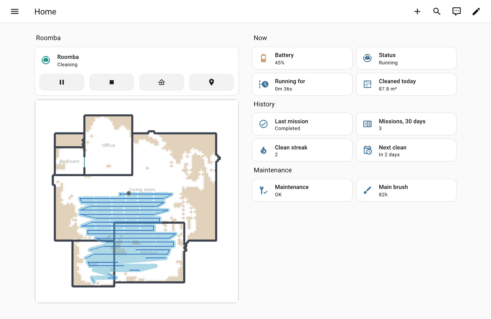
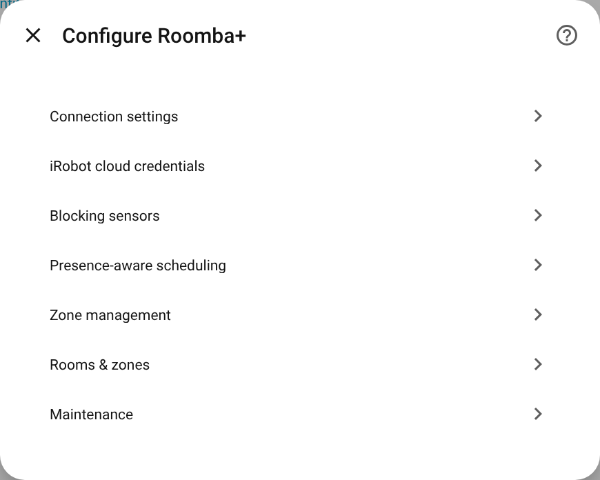

# Roomba+ for Home Assistant

**Your iRobot Roomba and Braava in Home Assistant — locally, with a live map, rooms,
maintenance and mission history.**

Roomba+ connects to Classic robots (600, 900, i, s, j series and Braava m6) over your own
network, with no cloud account and no polling, and to the newer V4/Prime robots (Combo and
Plus 400 series, Combo 505, Roomba Max) through iRobot's cloud. It is a custom integration
at Home Assistant's highest quality level, Platinum, in eight languages.

Screenshots come from a demo Home Assistant with a simulated Roomba 980; the rooms and
history are made up.

## Contents

- [Where to start](#where-to-start)
- [Highlights](#highlights)
- [Supported robots](#supported-robots)
- [How it compares](#how-it-compares)
- [Installation](#installation)
- [Setup](#setup)
- [First steps](#first-steps)
- [What's new in 4.6 (beta)](#whats-new-in-46-beta)
- [V4/Prime robots](#v4prime-robots)
- [Known limitations](#known-limitations)
- [Data privacy](#data-privacy)
- [Documentation](#documentation)
- [Removal](#removal)
- [Help and contributing](#help-and-contributing)
- [Credits](#credits)
- [License](#license)

## Where to start

| I want to … | Go to |
|---|---|
| Install Roomba+ | [Installation](#installation) |
| Set up my robot | [Getting started](docs/getting-started.md), step by step |
| Know what works on my robot | [Supported robots](#supported-robots) · Prime: [V4/Prime robots](#v4prime-robots) |
| Clean rooms, set schedules, keep up with maintenance | [Features](docs/FEATURES.md), one page per task |
| Get notified, use it in automations | [Notifications](docs/guides/notifications.md) · [Automations](docs/AUTOMATIONS.md) |
| Fix a problem | [Troubleshooting](docs/TROUBLESHOOTING.md) |
| Look up an entity, action or option | [Entities](docs/reference/entities.md) · [Actions](docs/reference/actions.md) · [Options](docs/reference/options.md) |
| See everything | [Documentation home](docs/README.md) |

## Highlights

- **Live map and rooms.** The path is drawn as the robot cleans, on a map with your rooms.
  Clean rooms by name with `roomba_plus.clean_room` or Home Assistant's own
  `vacuum.clean_area`, mapped to your Home Assistant areas.
- **Starts that fit your home.** `roomba_plus.smart_start` waits while a door is open or
  someone is home, cleaning can follow your presence, and `clean_overdue_rooms` or
  `auto_clean_dirty_rooms` pick only the rooms that need it.
- **Maintenance that knows your robot.** Filter, brushes, battery and dock parts count down
  from your robot's own usage, show up as a to-do list, a calendar and a repair when
  overdue, and link to a care guide.
- **Missions you can automate on.** Events when a mission starts and how it ended, the rooms
  it missed, the room it is in and when it will finish, and a record of every mission.
- **Answers for scripts and Assist** *(4.6, beta)*. `plan_clean` says whether a clean started
  now would be done in time; `get_rooms`, `get_missions` and `get_mission` return the rest.
- **Local first.** Classic robots work without an iRobot account; the account adds cloud
  room names, favourites and history. Nothing goes anywhere but your Home Assistant and
  iRobot — see [data privacy](docs/DATA_PRIVACY.md).

## Supported robots

| Series | Examples | Connection | Tested on |
|---|---|---|---|
| 600 | Roomba 694, 692, 671 | local | Roomba 694 |
| 900 | Roomba 980, 985 | local | Roomba 980 |
| i, s, j series | i3, i7+, s9+, j7+, Combo j9+ | local, iRobot account optional | i7+, s9+, j7+, Combo j9+ |
| Braava | jet m6 | local, iRobot account optional | Braava jet m6 |
| V4/Prime | Combo 105, Plus 405/410/416 Combo, Combo 505, Roomba Max 705 | iRobot cloud | several models, see [V4/Prime robots](docs/PRIME.md) |

**What works on which robot:**

| | 600 | 900 | i / s / j | Braava m6 | Prime |
|---|---|---|---|---|---|
| Live map and cleaning path | — | ✅ | ✅ | ✅ | ✅ |
| Clean by room | — | — rooms are found and tracked, the robot cannot be sent to one | ✅ | ✅ | ✅ |
| Room names, favourites, history from the iRobot cloud | — | history | ✅ with account | ✅ with account | ✅ |
| Presence-aware scheduling, demand cleaning | — | ✅ | ✅ | ✅ | ✅ |
| Room rhythms, overdue rooms, mission maps | — | — | ✅ with account | ✅ with account | ✅ |
| Maintenance reminders, to-do list, calendar | ✅ | ✅ | ✅ | ✅ | ✅ |
| Mop sensors: tank and pad | — | — | Combo models | ✅ | Combo models |
| Works without internet | ✅ | ✅ | ✅ | ✅ | — |

Each feature, and which robots it needs: [Features](docs/FEATURES.md) and [which generation has what](docs/reference/robots.md#which-generation-has-what).
Prime robots have their own page: [V4/Prime robots](docs/PRIME.md).

## How it compares

| | Roomba+ | Built-in Roomba integration | roomba_rest980 |
|---|---|---|---|
| Connection | Local push; iRobot account optional | Local push | Polls a rest980 Docker container; iRobot account required |
| Robots | 600, 900, i, s, j, Braava m6 and Prime | Classic robots; it lists 690, 890, 960, 980, s9+, Braava m6 | Smart Map robots (i, s, j) |
| Map and rooms | Live path, rooms map, cleaning by room and area | — | Floor plan from the cloud, no live path |
| Automation | Blocking sensors, presence, demand cleaning, mission events, response actions | Start, stop, return | Room selection, cloud routines |
| Entities | 270+ kinds across both generations, maintenance and history included | 13 | About 30, plus room selects and favourite buttons |

Neither of the other two supports Prime robots. The full comparison, with when to choose
which: [Roomba+, the built-in integration and roomba_rest980](docs/COMPARISON.md).

## Installation

Requires **Home Assistant 2025.5** or newer.

Install the current stable release, whatever your robot: one release line serves both
generations. Releases before 4.0 cannot connect to Prime robots at all, and the 4.1 and 4.2
lines have ended. Which version you have: Settings → Devices & services → Roomba+.

### Marketplace — Home Assistant 2026.11 and later

1. Settings → **Marketplace** → search for **Roomba+**.
2. Install it, then restart Home Assistant if it asks you to.

Roomba+ is in the catalog every Marketplace user sees, so there is no repository to add and
no GitHub account to connect. If you installed it from HACS before updating Home Assistant,
it moved to the Marketplace by itself and keeps getting updates.

### HACS — Home Assistant before 2026.11

1. HACS → search for **Roomba+**.
2. Download the newest release, then restart Home Assistant.

**Betas** are offered only when you switch them on for Roomba+: *Include pre-releases* in
the menu of its Marketplace page, or *Show beta versions* in HACS. The current beta is
**4.6.0b3** — see [what 4.6 adds](#whats-new-in-46-beta).

### Manual

Copy `custom_components/roomba_plus/` into the `custom_components` folder of your
configuration and restart Home Assistant.

## Setup

Settings → Devices & services → **Add integration** → **Roomba+**.

| Choice | When to use it | What you enter |
|---|---|---|
| **Set up with my iRobot account** (recommended) | Any robot; required for Prime | Your iRobot app email and password. Every robot on the account is found; the first is set up, the others appear under **Discovered** and need one click each. |
| A robot found on your network | Classic robots, without an account | Nothing: hold the robot's **HOME** button for about two seconds when asked, until it plays tones. |
| **Add manually** | Classic robots Home Assistant did not find | The robot's local IP address, as your router shows it, then HOME as above. You are asked for the robot's password only if reading it fails. |

You can add or change the iRobot account later: Roomba+ → **Configure** → *iRobot cloud
credentials*. A new IP address or password: ⋮ → **Reconfigure**.

Every option and what it does: [Options](docs/reference/options.md); what leaving one off costs: [here](docs/explanations/options.md).

> **Coming from the built-in Roomba integration or roomba_rest980?** Remove or stop it
> first — a robot takes one local connection at a time. Step by step:
> [moving to Roomba+](docs/MIGRATING.md).

## First steps

Step by step, with pictures: **[Getting started](docs/getting-started.md)**. In short:

1. **Look at the device page**: the controls, *Status*, *Readiness*, the parts, and the map.
2. **Name your rooms.** Smart Map and Prime robots take the names from your iRobot account; a
   900-series asks after three missions (Configure → *Rooms & zones*).
3. **Clean a room** with `roomba_plus.clean_room`, or by area with `vacuum.clean_area` once
   the rooms are matched to areas (Home Assistant 2026.3 and later).
4. **Pick a blueprint** under Settings → Automations & scenes → Blueprints: notifications,
   maintenance with Done and Later buttons, a start when everyone has left.
5. **Mark parts done** in `todo.<robot>_maintenance` when you replace or clean them.

## What's new in 4.6 (beta)

4.6.0b3 is a pre-release. Everything in it is additive, and none of it has run on a robot
yet, so reports are welcome.

- **Prime robots get the entities Classic robots already had** — mission and history
  sensors, the stuck event, room progress for missions started in the app, and more, each
  once the robot reports its data.
- **Mission events**: `roomba_plus_mission_started` and `roomba_plus_mission_result`, with
  event entities, the rooms skipped or not reached, and `roomba_plus.retry_missed_rooms`.
- **A start the robot ignored** is reported on `event.<robot>_command` and sent once more.
- **Response actions** `get_rooms`, `get_missions`, `get_mission` and `plan_clean`.
- **Current room and estimated end** as sensors (Prime, and Smart Map robots with an
  account), and **when each Home Assistant area was last vacuumed and mopped**.
- **Send home after a pause**, battery used per mission, and blueprints that install
  themselves.

Details: release notes [b1](release-notes/v4.6.0b1.md), [b2](release-notes/v4.6.0b2.md), [b3](release-notes/v4.6.0b3.md) · [upgrade notes](docs/UPGRADING.md#v460--from-v45x).

## V4/Prime robots

The newer robots — Combo and Plus 400 series, Combo 105 and 505, Roomba Max — have no
local connection; Roomba+ reaches them through iRobot's cloud, so they need your iRobot
account and internet. Rooms, zones, favourites, the live map, maintenance and mission
history work on them, and since 4.6 they get the entities Classic robots have wherever the
robot reports the data. Power off, spot cleaning and map training have no Prime command.
Details, and what is not yet confirmed on a robot: [V4/Prime robots](docs/PRIME.md).

## Known limitations

- **A 900-series robot cannot be sent to a room.** Roomba+ finds its rooms from where it
  cleaned and tracks them, but the robot only cleans the whole home. Its room shapes follow
  coverage, not walls.
- **A 600-series robot has no map**, so the live map and everything about rooms do not
  apply to it.
- **No voice sentences of its own.** Scripts that use the response actions can be run from
  Assist.

All of them, and why: [Known limitations](docs/explanations/limitations.md).

## Data privacy

Classic robots are reached on your own network; nothing leaves your Home Assistant unless
you add an iRobot account, and then only to iRobot, the same servers the app uses. Roomba+
has no server of its own, no analytics and no telemetry. A diagnostics download is made only
when you click it, and carries no password, address or account details. Everything stored,
how often the cloud is asked, and what a download contains: [Data privacy](docs/DATA_PRIVACY.md).

## Documentation

| | |
|---|---|
| [Documentation home](docs/README.md) | Every page, by what you want to do |
| [Getting started](docs/getting-started.md) | From installing to the first automatic clean |
| [Features](docs/FEATURES.md) | Everything Roomba+ does, by task, with a page for each |
| [Entities](docs/reference/entities.md) · [Actions](docs/reference/actions.md) · [Options](docs/reference/options.md) | Generated from the code: every id, field and setting |
| [V4/Prime robots](docs/PRIME.md) | What works on the cloud robots, what does not, and why |
| [Automations & dashboards](docs/AUTOMATIONS.md) | Recipes and the shipped blueprints |
| [Moving to Roomba+](docs/MIGRATING.md) | From the built-in integration or roomba_rest980, more robots, replacing a robot |
| [Troubleshooting](docs/TROUBLESHOOTING.md) | Common problems by topic, and how to send a diagnostics download |
| [Upgrade notes](docs/UPGRADING.md) | What changes when you update, version by version |
| [Data privacy](docs/DATA_PRIVACY.md) | Where your data goes, how often, and what a diagnostics download contains |
| [REST API](docs/API.md) | Endpoints for cards and scripts |
| [xiaomi-vacuum-map-card](docs/xiaomi-vacuum-map-card.md) | Using Roomba+ with the interactive map card |
| [Comparison](docs/COMPARISON.md) | Roomba+, the built-in integration and roomba_rest980 side by side |
| [Release notes](https://github.com/johnnyh1975/ha_roomba_plus/releases) | What changed in each version |

**Companion card.** [ha_roomba_plus_card](https://github.com/johnnyh1975/ha_roomba_plus_card)
puts the map, room buttons and mission history in one card. Add it as a custom repository of
type *Dashboard* (Marketplace: add from link, with a connected GitHub account). Home
Assistant's own cards are enough for the controls alone.

## Removal

1. Settings → Devices & services → Roomba+ → ⋮ → **Delete**, once for each robot. This also
   deletes everything Roomba+ stored for the robot: mission history, maps, coverage and
   maintenance timers. To keep it, call `roomba_plus.create_backup` first.
2. Remove Roomba+ in the Marketplace (or HACS), or delete `custom_components/roomba_plus`
   for a manual install, and restart Home Assistant.

The robot keeps its schedules and settings, and the iRobot app works as before.

## Help and contributing

- **Something wrong?** Open an [issue](https://github.com/johnnyh1975/ha_roomba_plus/issues)
  and attach a diagnostics download (device page → *Download diagnostics*). It carries no
  password, address or account details.
- **A robot or firmware not listed above?** A diagnostics download is often more useful than
  a description.
- **Translations** — English, German, French, Italian, Spanish, Portuguese, Dutch and Polish.
  A native speaker's corrections are welcome as an issue or a pull request.
- **Code** — pull requests are welcome; [AGENTS.md](AGENTS.md) has the rules and the checks
  to run. For anything larger than a small fix, open an issue first.

## Credits

**Field testing** — real-device reports from these people drove fixes, cancelled features
that did not hold up and shaped the plan: **Thonno** (i7+), **veronoicc** (i7+, i8+),
**boutXIII** (Braava jet m6), **ronluna** (S9+), **KingAntDesigns** (Braava jet m6, j7+),
**mdarocha** (i3+), **chairstacker**, **jayjay13011**, **DaRealGuGu**, **arielgr**,
**utkjmitch**, **jadestar1864** (V4/Prime), and since 4.3 among others **Baby-scarf** (two
Prime robots on one account), **tankdeer** (600), **rodelero1** (i7), **AdamVig** (j7+),
**AlbertoMPinto** (Combo j9+), **kyoheimukaida** (Combo j9+), **homux-tech** (Combo 505),
**pk-1966**, **nareso** (j7+), **ScenicSystemsLLC**, **molnarpeterhu** and **mattdmrc**.
Thank you all.

**Code** — **[@jouwdan](https://github.com/jouwdan)** found the second map URL in the Prime
map stream and the room outlines in the map bundle, and brought the Roomba Max 705 into the
tested set. **[@mdarocha](https://github.com/mdarocha)** contributed i3+ support, Prime
maintenance parity and presence fixes; **[@tar-gezed](https://github.com/tar-gezed)** the
Prime mission history without a `missionId` and the Prime map colours by cleaning mode;
**[@JoshHobbs](https://github.com/JoshHobbs)** the same room on two maps;
**[@Rickeeh](https://github.com/Rickeeh)** the inner rings of Prime map borders.

**Translations** — **mdarocha** (Polish) and **boutXIII** (French).

**Libraries and prior work** —
[roombapy](https://github.com/pschmitt/roombapy) for the local connection (Roomba+ needs
2.0.2 or newer and contributed the position protocol back to it);
[roombapy-prime](https://github.com/johnnyh1975/roombapy-prime), the companion library for
iRobot's cloud and Prime robots; [dorita980](https://github.com/koalazak/dorita980) by Facu
ZAK (koalazak), which first documented the local protocol, the cloud login and Smart Map
commands.

## License

[MIT](LICENSE)
