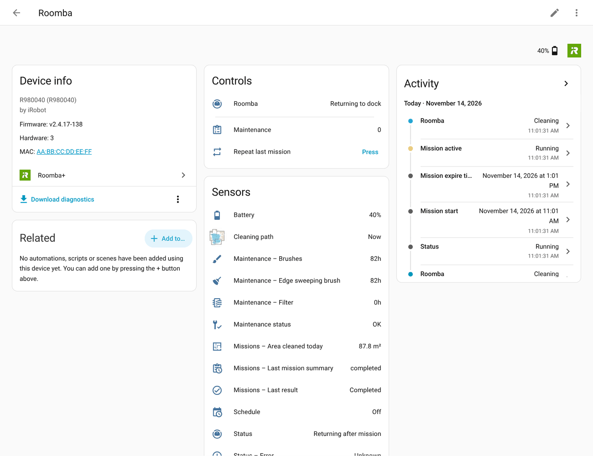

[Roomba+](../README.md) › [Documentation](README.md) › Features

# Features

What Roomba+ does, by what you want to do. Each line leads to the page that explains it.

## Clean

- **One room, several in order, a zone or a Home Assistant area**, with settings per room; skip the room it is in; name your rooms → [Clean rooms and zones](guides/clean-rooms.md)
- **Only when the house is ready**: blocking sensors, a paused robot sent home, a Prime robot's quiet hours and start blocks → [Start only when the house is ready](guides/start-conditions.md)
- **On a schedule, when everyone is out, when the floor is dirtier than usual, the rooms that are due** → [Schedules, presence and demand cleaning](guides/schedules.md)

## Keep it running

- **Parts and care tasks**: what is due, the to-do list, reminders, care guides with drawings, iRobot's part counters → [Maintenance](guides/maintenance.md)
- **Robot health**: battery and dock contacts, navigation, reset causes → [Maintenance: robot health](guides/maintenance.md#robot-health)

## See and use

- **Maps**: the live cleaning path, the rooms, a floor plan per map, the coverage heatmap, where the robot is → [Maps and dashboards](guides/dashboards-and-maps.md)
- **Notifications**: shipped blueprints, device triggers, event entities, events → [Notifications and blueprints](guides/notifications.md)
- **Scripts and Assist**: ask for the rooms, the missions or a plan; react to a mission's start → [Scripts, Assist and the mission record](guides/scripts-and-assist.md)
- **Ready-made recipes and a dashboard** → [Automations](AUTOMATIONS.md)

## Look something up

- [Robots and generations](reference/robots.md): Classic and Prime, which generation has what, mopping robots
- [Status, controls and diagnostics](reference/status-and-controls.md)
- [Entities](reference/entities.md), [Actions](reference/actions.md), [Options](reference/options.md): generated from the code
- [Events and device triggers](reference/events.md)
- [REST API](API.md)

## Understand it

- [How a 900-series finds its rooms](explanations/how-rooms-are-found.md)
- [How the maps are drawn](explanations/maps.md)
- [Progress and time estimates](explanations/estimates.md)
- [Mission history and statistics](explanations/history.md)
- [The words on your screen come from iRobot](explanations/words-from-irobot.md)
- [What leaving an option off costs you](explanations/options.md)
- [Known limitations](explanations/limitations.md)
- [V4/Prime robots](PRIME.md), [Data privacy](DATA_PRIVACY.md), [How it compares](COMPARISON.md)

## Where did it go?

Up to 4.6.0b2 this page held everything in one. Each of its sections now lives on the page that fits it; a link to one of the old sections lands here, on its row.

| Section | Now in |
|---|---|
| Tier legend | [robots](reference/robots.md#how-the-pages-say-which-robots) |
| Which generation, section by section | [robots](reference/robots.md#which-generation-has-what) |
| Status, control & error intelligence | [status-and-controls](reference/status-and-controls.md) |
| Debug capture | [status-and-controls](reference/status-and-controls.md#debug-capture) |
| Child lock, eco charge & gentle mode switches | [status-and-controls](reference/status-and-controls.md#controls) |
| Missions for scripts and Assist | [scripts-and-assist](guides/scripts-and-assist.md#ask-from-a-script-rooms-missions-plans) |
| Mission started, rooms and areas | [scripts-and-assist](guides/scripts-and-assist.md#when-a-mission-starts-and-which-room-it-is-in) |
| When each area was last vacuumed and mopped | [scripts-and-assist](guides/scripts-and-assist.md#when-each-area-was-last-vacuumed-and-mopped) |
| Send home after a pause | [start-conditions](guides/start-conditions.md#send-home-after-a-pause) |
| Cloud stream times — Prime | [status-and-controls](reference/status-and-controls.md#cloud-stream-times) |
| Blueprints | [notifications](guides/notifications.md#the-quickest-way-a-blueprint) |
| Room cleaning, zones & maps | [clean-rooms](guides/clean-rooms.md) |
| `clean_room` vs `vacuum.clean_area` | [clean-rooms](guides/clean-rooms.md#two-ways-to-clean-a-room) |
| Skipping the current room | [clean-rooms](guides/clean-rooms.md#skipping-the-current-room) |
| Cloud zone selector attributes | [clean-rooms](guides/clean-rooms.md#the-room-selects-attributes) |
| Smart Start with blocking sensor gate | [start-conditions](guides/start-conditions.md#blocking-sensors-and-smart-start) |
| Naming rooms and areas | [clean-rooms](guides/clean-rooms.md#naming-rooms-and-areas) |
| Zone management | [clean-rooms](guides/clean-rooms.md#zone-management) |
| Cloud zone sync | [clean-rooms](guides/clean-rooms.md#rooms-and-zones-from-the-irobot-account) |
| Room detection — 900-series | [how-rooms-are-found](explanations/how-rooms-are-found.md) |
| Room type suggestion | [clean-rooms](guides/clean-rooms.md#naming-rooms-and-areas) |
| Map drift detection | [maps](explanations/maps.md#map-drift) |
| Layout change detection | [maps](explanations/maps.md#layout-changes) |
| Battery / dock contact monitoring | [maintenance](guides/maintenance.md#robot-health) |
| Cleaning map | [dashboards-and-maps](guides/dashboards-and-maps.md#the-cleaning-map) |
| Rooms map | [dashboards-and-maps](guides/dashboards-and-maps.md#the-rooms-map) |
| Floor plan of each map | [dashboards-and-maps](guides/dashboards-and-maps.md#a-floor-plan-for-each-map) |
| Where the robot is: the device tracker | [dashboards-and-maps](guides/dashboards-and-maps.md#where-the-robot-is-the-device-tracker) |
| What the colours on the map mean | [dashboards-and-maps](guides/dashboards-and-maps.md#what-the-colours-on-the-map-mean) |
| Coverage map | [dashboards-and-maps](guides/dashboards-and-maps.md#the-coverage-map) |
| Room names in Japanese, Chinese or Korean | [dashboards-and-maps](guides/dashboards-and-maps.md#room-names-in-japanese-chinese-or-korean) |
| Room cleaning setup — HA areas | [clean-rooms](guides/clean-rooms.md#clean-by-home-assistant-area) |
| One-time setup | [clean-rooms](guides/clean-rooms.md#one-time-setup) |
| Using the action | [clean-rooms](guides/clean-rooms.md#using-the-action) |
| Maintenance & health | [maintenance](guides/maintenance.md) |
| Maintenance status and entries | [maintenance](guides/maintenance.md#the-maintenance-entries) |
| Configure → Maintenance | [maintenance](guides/maintenance.md#configure--maintenance) |
| Care guides | [maintenance](guides/maintenance.md#care-guides) |
| Maintenance repair issues | [maintenance](guides/maintenance.md#repair-issues-opt-in) |
| Maintenance calendar | [maintenance](guides/maintenance.md#maintenance-calendar-opt-in) |
| Remaining life sensors | [maintenance](guides/maintenance.md#the-part-sensors) |
| Cloud-synced consumables | [maintenance](guides/maintenance.md#parts-counted-by-irobot) |
| Status | [status-and-controls](reference/status-and-controls.md#status) |
| Clean Base / dock status | [status-and-controls](reference/status-and-controls.md#status) |
| Navigation health | [maintenance](guides/maintenance.md#robot-health) |
| Replacement tracking | [maintenance](guides/maintenance.md#care-reminders) |
| Care reminders | [maintenance](guides/maintenance.md#care-reminders) |
| Maintenance due binary sensor | [maintenance](guides/maintenance.md#the-maintenance-entries) |
| Maintenance to-do list | [maintenance](guides/maintenance.md#the-to-do-list) |
| Dock contact health | [maintenance](guides/maintenance.md#robot-health) |
| Wear Intelligence | [maintenance](guides/maintenance.md#the-part-sensors) |
| Device diagnostics | [maintenance](guides/maintenance.md#robot-health) |
| Health score trend | [maintenance](guides/maintenance.md#robot-health) |
| Reset diagnostics | [maintenance](guides/maintenance.md#robot-health) |
| Cleaning cadence health | [schedules](guides/schedules.md#rooms-that-are-due) |
| Mission history & room intelligence | [history](explanations/history.md) |
| Room rhythms & mission maps | [schedules](guides/schedules.md#rooms-that-are-due) |
| Mission log | [history](explanations/history.md#the-mission-log) |
| Mission progress | [estimates](explanations/estimates.md#mission-progress) |
| Mission phase sensors | [status-and-controls](reference/status-and-controls.md#missions-and-errors) |
| Room intelligence | [history](explanations/history.md#rooms-in-the-history) |
| Error intelligence | [status-and-controls](reference/status-and-controls.md#missions-and-errors) |
| Mission anomaly detection | [history](explanations/history.md#unusual-missions) |
| Anomaly explanation | [history](explanations/history.md#unusual-missions) |
| Stuck pattern time-correlation | [history](explanations/history.md#where-the-robot-gets-stuck) |
| Stuck hotspot clusters | [history](explanations/history.md#where-the-robot-gets-stuck) |
| Performance sensors | [history](explanations/history.md#performance-and-map-statistics) |
| Map intelligence | [history](explanations/history.md#performance-and-map-statistics) |
| HA Long-Term Statistics | [scripts-and-assist](guides/scripts-and-assist.md#long-term-statistics) |
| REST history API | [scripts-and-assist](guides/scripts-and-assist.md#reading-the-history-from-outside-the-rest-api) |
| Presence & scheduling | [schedules](guides/schedules.md) |
| Cleaning schedule calendar | [schedules](guides/schedules.md#the-schedule-as-a-calendar) |
| Presence-aware scheduling | [schedules](guides/schedules.md#presence-aware-scheduling) |
| Demand cleaning | [schedules](guides/schedules.md#demand-cleaning) |
| Presence analytics | [schedules](guides/schedules.md#presence-aware-scheduling) |
| Mission progress is an estimate, not coverage | [estimates](explanations/estimates.md#progress-is-an-estimate-not-coverage) |
| Favourites are per robot | [clean-rooms](guides/clean-rooms.md#favourites-are-per-robot) |
| Pad washing allowed | [robots](reference/robots.md#pad-washing-and-drying) |
| Pad wash interval: what the numbers mean | [robots](reference/robots.md#pad-wash-interval-what-the-numbers-mean) |
| Pad wetness | [robots](reference/robots.md#pad-wetness) |
| The mop tank sensor is unreliable on some Combos | [robots](reference/robots.md#the-mop-tank-sensor-is-unreliable-on-some-combos) |
| Per-room preferences | [clean-rooms](guides/clean-rooms.md#per-room-preferences) |
| Settings showing an unusual value | [status-and-controls](reference/status-and-controls.md#controls) |
| Started by, on Prime | [status-and-controls](reference/status-and-controls.md#status) |
| The third phase category | [status-and-controls](reference/status-and-controls.md#status) |
| Do Not Disturb | [start-conditions](guides/start-conditions.md#quiet-hours-do-not-disturb) |
| Start blocked | [start-conditions](guides/start-conditions.md#when-a-prime-robot-cannot-start) |
| Prime robots: what Classic already had | [PRIME](PRIME.md#what-prime-shares-with-classic) |
| Connectivity, mop & configuration reference | [options](reference/options.md) |
| Braava / mop sensors | [robots](reference/robots.md#braava) |
| Configuration reference | [options](reference/options.md) |
| Diagnostics download | [status-and-controls](reference/status-and-controls.md#diagnostics-download) |
| The words on your screen come from iRobot | [words-from-irobot](explanations/words-from-irobot.md) |
| Every option, and what it costs you to leave it off | [options](explanations/options.md) |
| The map (options) | [options](explanations/options.md#the-map) |
| Entities you may not want | [options](explanations/options.md#entities-that-take-space) |
| Presence and demand cleaning (options) | [options](explanations/options.md#presence-demand-cleaning-and-blocking-sensors) |
| Blocking sensors (options) | [options](explanations/options.md#presence-demand-cleaning-and-blocking-sensors) |
| Multi-robot households | [options](explanations/options.md#presence-demand-cleaning-and-blocking-sensors) |
| Why the floor is getting dirtier | [history](explanations/history.md#performance-and-map-statistics) |
| What the mission record says went wrong | [history](explanations/history.md#the-mission-log) |
| Known limitations | [limitations](explanations/limitations.md) |
| Planned, not scheduled | [limitations](explanations/limitations.md#planned-not-scheduled) |
| Events & device triggers | [events](reference/events.md) |
| Event bus | [events](reference/events.md#event-bus) |
| Event entities | [events](reference/events.md#event-entities) |
| Device triggers | [events](reference/events.md#device-triggers) |

---

[Documentation home](README.md) · [Troubleshooting](TROUBLESHOOTING.md) · [Questions and reports](https://github.com/johnnyh1975/ha_roomba_plus/issues)
