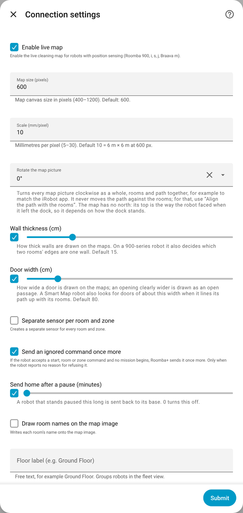

[Roomba+](../../README.md) › [Documentation](../README.md) › What leaving an option off costs you

# What leaving an option off costs you

Nothing under **Configure** is required; the defaults are what a robot does out of the box. This page says what the optional features cost and why some are off. Every option with its text and menu path: [Options](../reference/options.md). How often each part talks to the cloud: [Data privacy](../DATA_PRIVACY.md).

## The map

**Applies to:** Classic robots with position sensing; rotation, names and zone layers on every map

| Option | Default | What it costs, or why it is set so |
|---|---|---|
| Enable live map | on | Robots with position sensing only (900, i, s, j, Braava m). Off: no cleaning path, no room tracking by position, no areas on a 900-series |
| Map size, Scale | 600 px, 10 mm/px | At 600 px and 10 mm per pixel the picture covers 6 m × 6 m; a larger home needs a larger scale |
| Rotate the map picture | 0° | Turns every picture as a whole, rooms and path together, and never moves the path against the rooms. The map's top is the way the robot left the dock; turn it until it matches how you picture the floor. A saved change reaches every picture at once |
| Draw room names | off | [xiaomi-vacuum-map-card](../xiaomi-vacuum-map-card.md) draws its own names, so drawing them into the image as well would show each one twice. Switch it on for a plain picture card. A room without a name shows its number |
| Draw clean zones, keep-out zones, no-mop zones | off | They clutter a small canvas. They do not need a running mission |

## Entities that take space

**Applies to:** all robots; the favourite buttons option on Prime

| Option | Default | What it costs, or why it is set so |
|---|---|---|
| Show cleaning schedules as a calendar | **on** | A calendar entity, and with it a calendar in the sidebar |
| Show maintenance as a to-do list | **on** for a robot added from 4.5.0 | A to-do list in the sidebar (Configure → Maintenance) |
| Cleaning reminders | off | A sensor, four "cleaned" buttons and cleaning items in the to-do list (Configure → Maintenance) |
| Pets in the household | off | With cleaning reminders on: filter and main brushes twice a week instead of once |
| Maintenance calendar | off | A second calendar, read-only due dates as all-day events |
| Hide the maintenance diagnostic entities | off | "Last replaced", "wear rate" and "days until due" per part; a new installation creates them disabled anyway |
| Create a button for each saved favorite | off | Prime robots: one button per favourite, a lot of buttons on a busy account. Classic robots get their favourites' buttons without asking |
| Separate sensor per room and zone | off | One "last cleaned" sensor per room and saved zone; the cleaning history sensor holds the same in one entity |

The calendar and the to-do list are the same kind of thing and default differently on purpose: the calendar existed before its option did, and switching it off for people already using it would have taken something away. **Both take a place in Home Assistant's sidebar**, which is the user's space rather than an integration's; that is why the list is asked for.

## Presence, demand cleaning and blocking sensors

**Applies to:** all robots; presence on robots with a schedule hold and on Prime; demand cleaning on Smart Map robots with the account and Prime

| Option | What it does |
|---|---|
| Presence-aware scheduling | Holds the robot's schedule while somebody is home ([guide](../guides/schedules.md#presence-aware-scheduling)) |
| Demand cleaning | Starts a clean when the floor is clearly dirtier than usual ([guide](../guides/schedules.md#demand-cleaning)) |
| Blocking sensors | Keeps a start back while a sensor is on ([guide](../guides/start-conditions.md)) |
| Floor label | Free text, such as "Ground Floor": groups robots in the fleet view and the area dialog |

All three work on both generations. Turning presence scheduling or demand cleaning on or off reloads the robot, so it takes effect at once.

---

[Documentation home](../README.md) · [Troubleshooting](../TROUBLESHOOTING.md) · [Questions and reports](https://github.com/johnnyh1975/ha_roomba_plus/issues)
