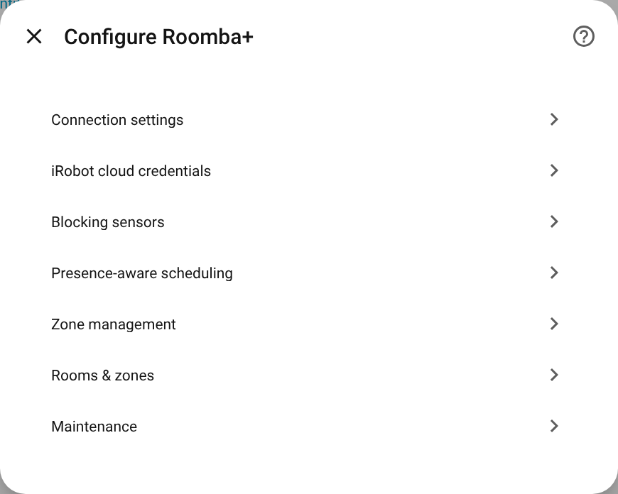
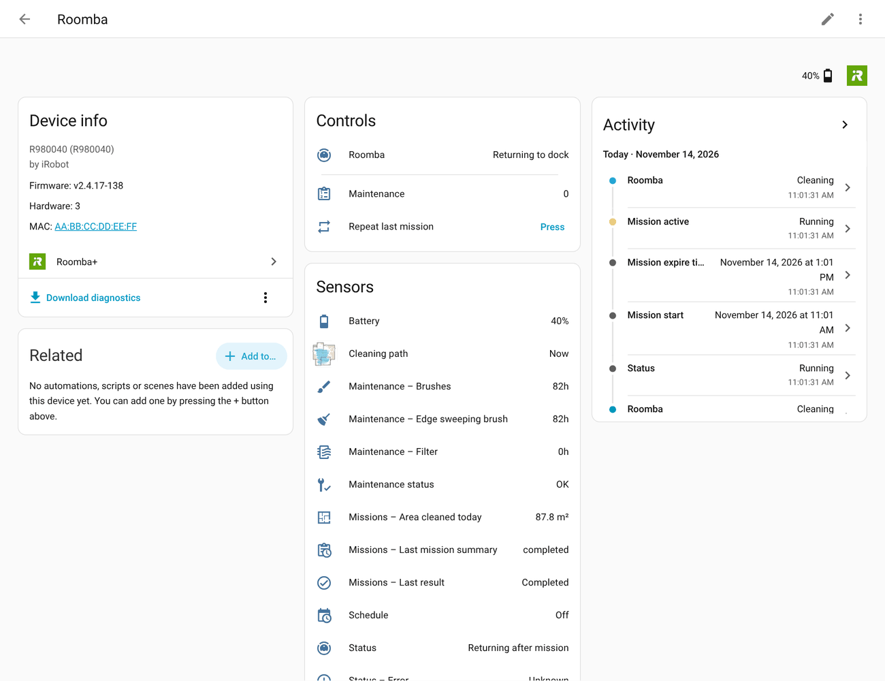
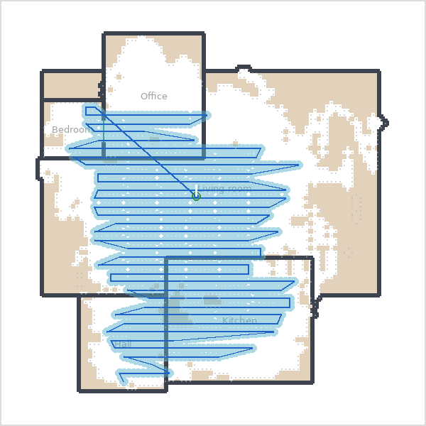
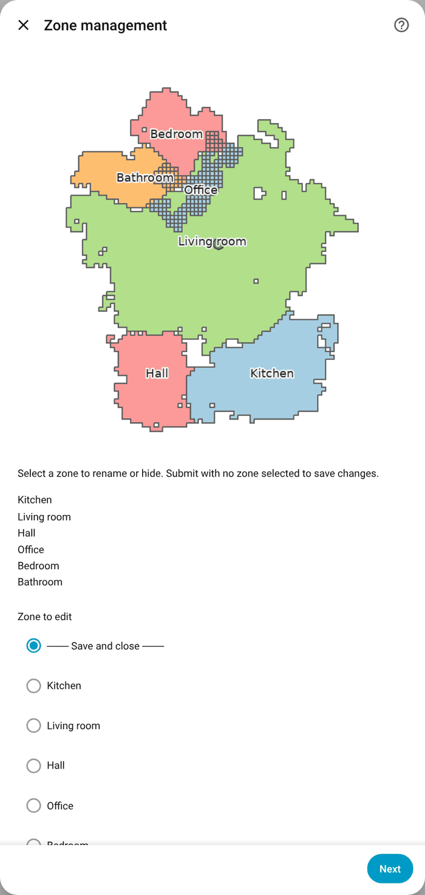
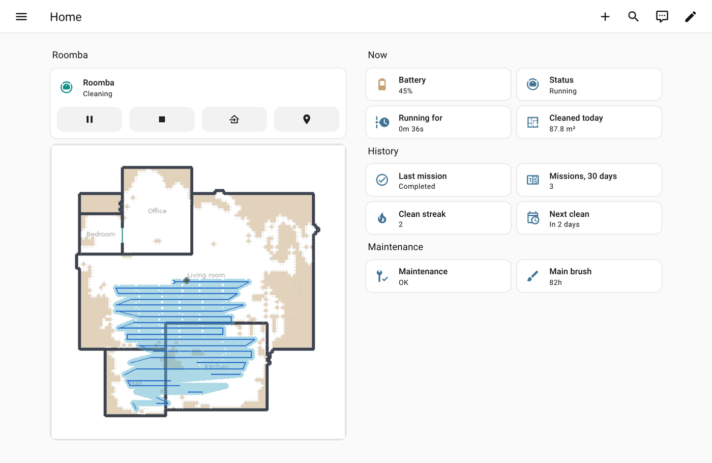

[Roomba+](../README.md) › [Documentation](README.md) › Getting started

# Getting started

From installing Roomba+ to the first clean that starts on its own, in eight steps. About twenty minutes, plus the missions a 900-series needs before it knows its rooms.

**Applies to:** all robots. Where Classic and Prime differ, the step says so. Not sure which yours is? A robot you set up in the **iRobot Home** app with a local connection is Classic; a Roomba Max, a Combo 400-series or another robot that iRobot's newer app sets up only through the cloud is Prime. [Robots and generations](reference/robots.md).

## 1. Before you start

- **Home Assistant 2025.5** or newer.
- **Your iRobot account**: the email and password of the iRobot app. Required for a Prime robot; recommended for a Classic one (room names, floor plan, part counters).
- **Classic robots only:** the robot on the same network as Home Assistant, and nothing else holding its local connection. The built-in Roomba integration and roomba_rest980 each take that connection; remove or stop them first ([Moving to Roomba+](MIGRATING.md)).

## 2. Install

On Home Assistant 2026.11 and later: Settings → **Marketplace** → search for **Roomba+** → install, and restart if asked. On an older Home Assistant: HACS → search for **Roomba+** → download → restart. Other ways: [Installation](../README.md#installation).

## 3. Add the robot

Settings → Devices & services → **Add integration** → **Roomba+**, then one of:

| Choice | For | What you do |
|---|---|---|
| **Set up with my iRobot account** (recommended) | every robot; the only way for Prime | Enter the app's email and password. Every robot on the account is found; the first is set up, the others appear under **Discovered**, one click each |
| A robot found on your network | Classic, without an account | Hold the robot's **HOME** button for about two seconds when asked, until it plays tones |
| **Add manually** | Classic robots Home Assistant did not find | Enter the robot's IP address from your router, then HOME as above |

You can add the iRobot account to a Classic robot later: Roomba+ → **Configure** → *iRobot cloud credentials*.



Nothing under Configure is required; the defaults are what a robot does out of the box. [What each option does](reference/options.md).

## 4. Look around the device page

Settings → Devices & services → Roomba+ → your robot.



- **Controls**: the vacuum itself (start, pause, dock), the cleaning mode and passes, and on Prime the suction and mop settings.
- **Sensors**: *Status* (what the robot is doing), *Readiness* (whether it can start, and why not), the battery, the parts.
- **Diagnostic**: connection, errors, mission figures. Some are off at first; turn them on here.

Every entity and its id: [Entities](reference/entities.md). The ids are English in every language: `sensor.<robot>_battery`, `todo.<robot>_maintenance`.

## 5. Run a first clean

Press **Start** on the vacuum, or call `vacuum.start`. While it runs:

- the **map** (`image.<robot>_map` on Classic robots with position sensing, `image.<robot>_prime_cleaning_map` on Prime) draws the path;
- *Mission progress* and *Current room* follow the robot ([how](explanations/estimates.md));
- when it docks, the mission lands in the history and `event.<robot>_mission_completed` fires.



A 600-series has no map: the robot works, the map entities are not there. [Maps and dashboards](guides/dashboards-and-maps.md).

## 6. Name the rooms

- **Prime, and Smart Map robots with the iRobot account:** the rooms come with their names from the account. Nothing to do.
- **Smart Map robots without the account:** add the account (step 3), or enter room numbers under Configure → *Manually enter Smart Map zones*.
- **900-series:** the robot keeps no map, so Roomba+ finds areas in its runs. After three missions that started on the dock, a repair notice asks you to name them: Configure → *Rooms & zones*, one field per numbered area on the picture. A 900-series cannot be sent to an area, but its areas name where it is and what a mission covered. [How a 900-series finds its rooms](explanations/how-rooms-are-found.md).



## 7. Clean a room, and match rooms to areas

```yaml
action: roomba_plus.clean_room
target:
  entity_id: vacuum.roomba
data:
  room_name: [Kitchen, Hallway]
```

On Home Assistant 2026.3 and later, also match the robot's rooms to your Home Assistant areas once: the vacuum entity → ⚙ → **Map vacuum segments to areas**. Then `vacuum.clean_area` cleans by area, and the device tracker, the current-room sensor and the room events name the area too. [Clean rooms and zones](guides/clean-rooms.md).

## 8. Let it start on its own, and tell you

- **A blueprint is the quickest way.** Settings → Automations & scenes → **Blueprints**: *Roomba+ Smart Start on Away* starts cleaning when everyone leaves; *Roomba+ Curated Notifications* tells you when a mission ends or the robot is stuck. Fill in the robot and your notification action. [All blueprints](guides/notifications.md).
- **Hold a start back** while a door is open or someone is home: Configure → *Blocking sensors*, then start with `roomba_plus.smart_start` instead of `vacuum.start`. [Start only when the house is ready](guides/start-conditions.md).
- **The robot's own schedule** is a calendar, `calendar.<robot>_schedule` (`calendar.<robot>_prime_schedule` on Prime); create, move or delete a cleaning there and it reaches the robot. [Schedules](guides/schedules.md).

## Then: maintenance

`todo.<robot>_maintenance` lists the parts and care tasks; an item opens when it is due. Tick it off when you replace or clean the part, and the counter starts again (on Prime at iRobot too). Each item links a care guide with a drawing of your robot. The *Roomba+ Maintenance* blueprint sends the same as a notification with *Done* and *Later* buttons. [Maintenance](guides/maintenance.md).



**Next:** a dashboard like the one above ([Automations](AUTOMATIONS.md#dashboard-example)), everything Roomba+ can do by task ([Features](FEATURES.md)), and when something does not work, [Troubleshooting](TROUBLESHOOTING.md).

---

[Documentation home](README.md) · [Troubleshooting](TROUBLESHOOTING.md) · [Questions and reports](https://github.com/johnnyh1975/ha_roomba_plus/issues)
