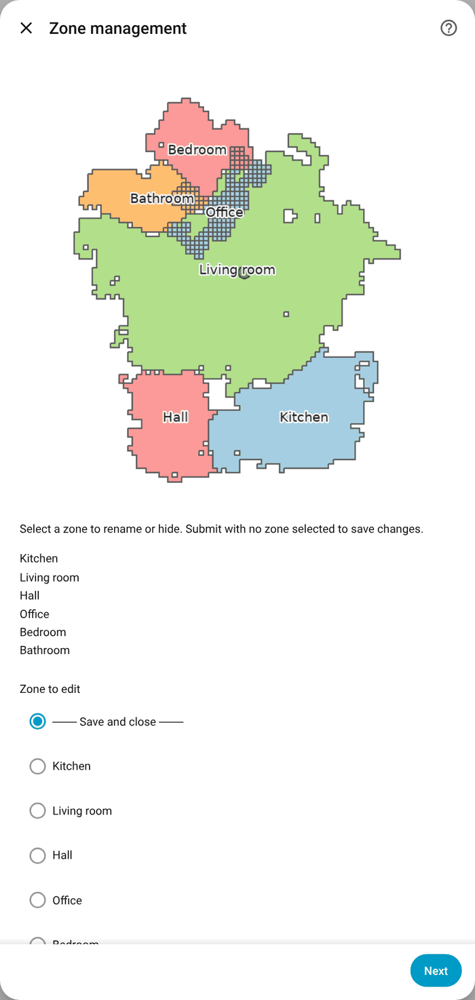

[Roomba+](../../README.md) › [Documentation](../README.md) › Clean rooms and zones

# Clean rooms and zones

Send the robot to one room, several rooms in an order, a saved zone or a Home Assistant area, and give the rooms the names you use.

**Applies to:** Smart Map robots (i, s, j, Combo, Braava m6) · Prime. A 900-series keeps no map of rooms; Roomba+ finds areas on it for the map and the history, but the robot cannot be sent to one. A 600-series has no map.

## Two ways to clean a room

| | `roomba_plus.clean_room` | `vacuum.clean_area` |
|---|---|---|
| Home Assistant | any version | 2026.3 or newer |
| Setup | none | map the robot's rooms to areas once |
| You name the room by | its name (`"Kitchen"`) | the Home Assistant area |
| After the robot retrains its map | keeps working | asks you to map the rooms again |

```yaml
# clean_room: any Home Assistant version, no setup
action: roomba_plus.clean_room
target:
  entity_id: vacuum.roomba
data:
  room_name:
    - Kitchen
    - Hallway
  ordered: true   # clean in this order rather than the most efficient one
  two_pass: true  # optional: overrides the robot's current setting for this job
```

**Settings per room.** Use `room_passes` instead of `room_name` when the rooms of one job need different treatment. Each room can carry its own `two_pass`, `cleaning_mode`, `smart_scrub` and `pad_wetness`:

```yaml
action: roomba_plus.clean_room
target:
  entity_id: vacuum.roomba
data:
  room_passes:
    - name: Kitchen
      two_pass: true
    - name: Bathroom
      cleaning_mode: mop
      pad_wetness: 3
    - name: Hallway   # nothing of its own: the call-level field, then the robot's current setting
  ordered: true
```

On Prime robots `two_pass`, `cleaning_mode` and `smart_scrub` go out per room; `pad_wetness` is a Classic field and is not sent to them. `room_name` and `room_passes` are mutually exclusive.

The cleaning mode chosen on the vacuum (the *Cleaning mode* select) applies to every start, room and zone cleaning included; see [Controls](../reference/status-and-controls.md#controls).

## Clean by Home Assistant area

**Applies to:** Smart Map robots with the iRobot account · Prime · **Needs:** Home Assistant 2026.3

`vacuum.clean_area` is Home Assistant's own action for cleaning by area, the same areas your lights and heating use. On an older Home Assistant, `roomba_plus.clean_room` does the same without any setup.

### One-time setup

1. Home Assistant raises a repair notice, **Map vacuum segments to areas**. That is expected.
2. Open the vacuum entity → ⚙ Entity settings → **Map vacuum segments to areas**.
3. Match each of the robot's rooms to a Home Assistant area.
4. Save.

The left side of the dialog lists the robot's rooms with their names from the iRobot account, grouped by floor if you set a floor label under Configure. The right side is your Home Assistant areas. You match them yourself: room names and area names differ by language and spelling, and a wrong automatic match, cleaning the wrong room, would be worse than none. It takes about a minute. If the robot retrains its map later, Home Assistant asks you to confirm the mapping again.

### Using the action

```yaml
action: vacuum.clean_area
target:
  entity_id: vacuum.roomba
data:
  cleaning_area_id:
    - living_room    # the area id, not the room name
    - kitchen
```

The area of a room is used everywhere Roomba+ names a room's area: the device tracker, the current-room sensor, the room events and `get_rooms`.

## Skipping the current room

**Applies to:** Classic robots that offer skipping (button and command) · Prime (command only, not yet confirmed on a robot)

The iRobot app's *Skip*: the robot leaves the room it is cleaning and goes on to the next room of the mission.

- **Button** `button.{name}_skip_room` (*Skip current room*), on Classic robots that offer skipping. It can be pressed only while the robot cleans.
- **Command**, for automations and scripts:

```yaml
action: vacuum.send_command
target:
  entity_id: vacuum.roomba
data:
  command: skip
  params:          # optional: which room, if room tracking does not know it
    room: Bathroom # a name or an id of the mission's rooms
```

On Classic robots Roomba+ sends what the iRobot app sends: the mission's map and the one room to skip. It goes out only where the app offers skip, and is refused with the reason otherwise:

| Condition | Refused with |
|---|---|
| The robot offers skipping (`cap.mc` 2 or 3) | "This robot does not offer skipping a room." |
| The robot cleans or drives between rooms (phase `run`); not paused, charging or on its way home | "A room can only be skipped while the robot is cleaning" |
| A room mission started with its map (`clean_room`, a room or zone selection, the app's room choice) | "Only a room mission started with its map can skip a room." |
| The room is known: room tracking's current room in a mission sent in order, or the room named in `params` | "The room to skip is not known." |

- **The last room of a mission sends the robot home** (pause, then dock, as *Return to base*), since nothing is left to clean. The Prime app does the same.
- **Room tracking moves on.** The skipped room counts as done at once: the remaining time leaves it out and room history does not record it as cleaned. The current room moves when a position confirms the next room, or after 20 seconds, unless the latest position still lies in the skipped room.
- **Confirmed on two Classic robots**, an i7+ among them.
- **Prime robots** get the plain `skip` their app sends, through the command only; no Prime robot has been seen taking it yet, so there is no button for them.
- **The diagnostics** keep each attempt under `field_evidence.skip_attempts`: what was sent, how the room was found, and the mission 20 seconds and a minute later.

## Naming rooms and areas

**Applies to:** Classic robots · Prime robots take their names from the account.

Configure → **Rooms & zones**

The form shows the robot's map, with each unnamed room or area drawn with its number, and one empty field per number. Type a name into the fields you want and leave the rest empty. Nothing outside Home Assistant is needed: the iRobot app shows no room numbers, so the map in the form is where they are.

- **Smart Map robots with the iRobot account added:** every room and zone takes its name from the account, so there is usually nothing to name. The form lists only rooms **on the map** that have no name anywhere, and shows the room map with their numbers. Region numbers known only from old schedules or earlier cleans are on no map and are not asked about.
- **Smart Map robots without the account:** Roomba+ knows the rooms only by number and has no map to show, so the step explains this instead of asking. Add the account (Configure → iRobot cloud credentials) and the names and the room map appear on their own. If you know a room's number already, Configure → *Manually enter Smart Map zones* still takes it.
- **Robots without a Smart Map (900 series):** the robot keeps no map; the areas are ones Roomba+ finds in its cleaning runs ([how](../explanations/how-rooms-are-found.md)). The form shows each area as a coloured patch with its number, or its name once it has one, and the dock as a green dot. The picture is drawn from the dock, so it may be turned against your floor plan. It comes from the *Cleaning path* map entity, which must be on (Connection settings → *Enable live map*). Named areas appear in the *Select zone* list and in the mission history; a 900-series cannot be sent to an area.

When there is no map to show (the map image entity is disabled, or the robot has not cleaned yet) the step says so rather than asking for names nobody can match to a room.

Rooms you have not named fall back to iRobot's own room type where its classification is confident, "Living Room" rather than "19", wherever room sizes or accessibility scores are shown. A name you set always wins.

## Zone management

**Applies to:** Classic robots



Configure → **Zone management**

- Browse all zones in one list, with the area map above it on a 900-series: each area in its colour with its name or number.
- Rename any zone. On a Smart Map robot the new name is used alongside the account's name, and `clean_room` takes either.
- Hide zones: they leave the selects, `clean_room` and repair issues.
- **900-series areas:** hide an area that is not a real space (for example one left by a mission that started away from the dock): it is no longer drawn as an area, leaves the area select and is not recorded as cleaned. Give several areas the same name to make one room of them: the select and the mission's cleaned rooms list that name once. The areas themselves stay separate on the map, and an area cannot be split.
- Changes are saved together or not at all.

## Rooms and zones from the iRobot account

**Applies to:** Smart Map robots with the iRobot account · Prime

- Room and zone names come from the Smart Map; there is nothing to name by hand.
- One select entity per floor; several Smart Maps are supported.
- Each routine saved in the iRobot app (a *favourite*) appears as a button; on a Prime robot when *Create a button for each saved favorite* is on.
- `clean_room` uses the account's names; a new map version is picked up at once.
- Prime robots offer their zones beside their rooms in the area-mapping dialog, so a zone can be mapped to an area the same way a room can.

**Listing rooms and zones in a template.** The *Rooms overdue* sensor carries a `rooms` attribute, rooms and zones together, keyed by the names `clean_room` and `clean_zone` expect, and `overdue_rooms`, a plain list sorted worst first:

```jinja

  {{ name }}

```

**Where Prime zone names come from, and why one may be missing.** Rooms are read from each map's own metadata, which always carries them. Zones are not: their names live in the map *version* document, plus whatever the last cleaning command happened to label. That document carries zones on some robots and not on others, so a zone of yours may be absent from these lists while the map shows it. It is not a setting and there is nothing to try, but it is worth reporting. A zone can also be missing because no map has been drawn yet; the list fills itself when the map arrives.

### The room select's attributes

`select.{name}_cloud_zone_{map}` (one per floor, with the iRobot account added) carries per-room data as attributes:

| Attribute | Type | Notes |
|---|---|---|
| `region_icons` | `dict[str, str]` | Room name → icon |
| `region_areas_m2` | `dict[str, float]` | Room name → floor area in m². Computed once from the floor plan; a map retrain recomputes it. Present only for the map the floor plan showed when it was computed (with more than one Smart Map, the map of the last command), absent rather than zero on other floors |
| `learning_percentage` | `int` | Map-learning progress for this floor |
| `region_count` / `zone_count` | `int` | Counts for this map |
| `is_active_map` | `bool` | Whether this is the robot's current map. For information only: a robot takes a room command for any of its maps |

## Per-room preferences

**Applies to:** Prime · not yet confirmed on a robot

`image.{name}_rooms_map` carries a `room_preferences` attribute: what each room is already set to in the iRobot app.

```
{ "7": {"profile": "deep", "suction_level": 4, "two_pass": true} }
```

Keys are room ids. Each value carries only what that room reports (`profile`, `suction_level`, `two_pass`, `carpet_boost`, `scrub`), and **an absent key means the robot did not report it, which is not the same as a zero.** The settings are read under the mode the room last ran in, because the robot stores one set per mode.

Use it to honour a room's own configuration instead of overriding it; see [Automations](../AUTOMATIONS.md#cleaning-a-room-the-way-it-is-set-up). A diagnostics download includes it and says why when it is empty.

## Favourites are per robot

**Applies to:** robots with the iRobot account

Your iRobot account's favourites are shared across every robot on it, but each favourite names the robot it was built for. **Only that robot gets a button.** A favourite that names no robot is shown under all of them. Pressing a favourite meant for another robot would send that robot's map regions to this one.

`roomba_plus.run_favorite` runs a favourite by its id. A favourite carries its own map, so it is the shortest way to a room on another floor.

---

[Documentation home](../README.md) · [Troubleshooting](../TROUBLESHOOTING.md) · [Questions and reports](https://github.com/johnnyh1975/ha_roomba_plus/issues)
