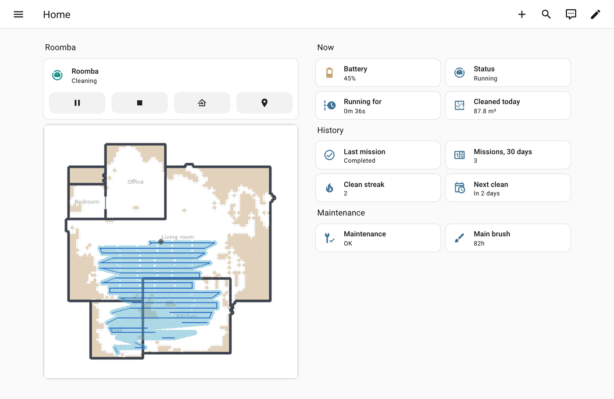
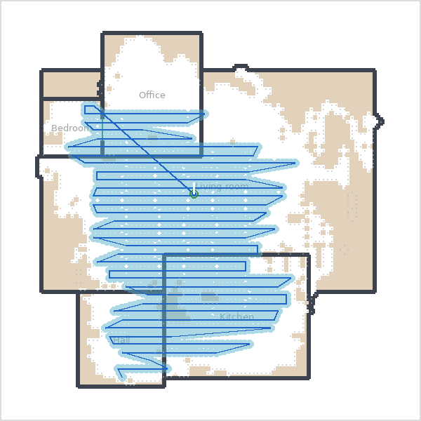
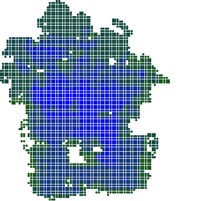

[Roomba+](../../README.md) › [Documentation](../README.md) › Maps and dashboards

# Maps and dashboards

The map images Roomba+ draws, what their colours mean, where the robot is, and how to put them on a dashboard. How the pictures are framed, mirrored and turned: [How the maps are drawn](../explanations/maps.md).



## On a dashboard

**Applies to:** all robots; the map cards on robots that have maps

- **Home Assistant's own cards** are enough for the controls: a tile or the vacuum card for the robot, a *picture entity* card for a map image.
- **The companion card**, [ha_roomba_plus_card](https://github.com/johnnyh1975/ha_roomba_plus_card), puts the map, room buttons and mission history in one card. Add it as a custom repository of type *Dashboard* (Marketplace: add from link, with a connected GitHub account).
- **xiaomi-vacuum-map-card** has a Roomba+ platform (card version 2.4.1 or newer): pick **Roomba+** as `vacuum_platform` in the card editor and press **Generate Room Configs**; it reads the map's `rooms` attribute and builds the room overlay. Full setup: [xiaomi-vacuum-map-card](../xiaomi-vacuum-map-card.md).

```yaml
type: custom:xiaomi-vacuum-map-card
entity: vacuum.roomba
vacuum_platform: roomba_plus        # then "Generate Room Configs"
map_source:
  camera: image.roomba_rooms_map
calibration_source:
  camera: true                      # reads calibration_points
```

## The cleaning map

**Applies to:** robots with position sensing (900, i, s, j, Braava m) · Prime (`image.{name}_prime_cleaning_map`) · Configure → Connection settings → *Enable live map*



`image.{name}_map` (shown as *Cleaning path*; an installation from an older version may call it `image.{name}_cleaning_map`) is the live map: the robot's path in blue over the cleaned floor in light blue, the dock, the robot with its heading, and stuck events. It survives a restart of Home Assistant.

```yaml
type: picture-entity
entity: image.roomba_map
show_name: false
show_state: false
```

**Robots that do not report their position.** Some Smart Map robots never send their position over the local connection (an i3 on `daredevil` firmware, for one). Roomba+ goes by what the robot reports, not by a model list:

- **It asks the robot where it is** while it cleans, about once a second, and draws the path live; the iRobot app asks the same way. Configure → *Connection settings* → *Ask the robot for its position* (on by default, offered only to such robots). The robot's tracker carries the same position (`x_mm`/`y_mm`, `map_x_mm`/`map_y_mm`, `position_source: request`). Details: [the path of a robot that is asked for its position](../explanations/maps.md#the-path-of-a-robot-that-is-asked-for-its-position).
- **Without that, or when the robot does not answer**, and with the iRobot account added, the map shows **the last mission's coverage as iRobot's cloud recorded it**, the data the app draws its after-clean map from. It is fetched per mission, checked against that mission's number, and kept until a newer mission arrives. Keep-out and clean-zone outlines are not drawn on it: they are placed in a different frame from the cloud's picture.

## The rooms map

**Applies to:** Smart Map robots with the iRobot account · Prime (there `image.{name}_prime_cleaning_map` is the rooms map with the live path on it)

`image.{name}_rooms_map` shows the rooms of the robot's floor plan, each in its own colour, with names. On a Classic robot it appears once the robot's positions have been lined up with the floor plan, usually after two missions that went through doors; on a robot that reports no position of its own the lining up starts from the cloud's room events. It is drawn once per map version.

- **Walls and doors.** Where two rooms touch is an opening (a door, or an open passage when clearly wider than the *Door width* option); every other edge is a wall as thick as *Wall thickness*. Prime maps that come with iRobot's own floor plan keep its walls and get the doors marked.
- **Zones are outlines**, not filled shapes: a zone sits inside a room, and filling it would hide the room. Configure → Connection settings → *Draw clean zones*, *Draw keep-out zones*, *Draw no-mop zones*.
- **Cleaning modes on Prime.** When the robot sends its operating modes with the map, the rooms map and the live map show vacuuming (green), mopping (blue) and both at once (teal); travel without cleaning is grey and does not count as covered. During a run the live positions are shown; after it, the robot's own classified path replaces them if it arrived after the run's first position.
- **Which map, with more than one Smart Map.** The rooms map shows the map the robot's last command went to. Without such a command (a start that names no map, or after *Smart Map localization failed*) it shows the map edited most recently, the one the room list uses. This changes only what is shown: room and zone commands go to the map of their room, and the account's own "active map" is not touched. The diagnostics say which map is shown and why (`floor_plan_pmap_id`, `floor_plan_map_source`).
- **The rooms map and the cleaning path share one frame**: both publish the same `calibration_points`, so one can lie over the other in a map card, and a mission that covered part of the house shows as that part.

### Attributes for map cards

Both map images carry `calibration_points` and `rooms`. Each entry of `rooms` is named as the room select names it (your alias from Zone management, then the account's name, then a name typed into the naming notice, then `Zone N`) and carries `region_id`, the robot's own id for the room; `room_id` is the ASCII slug of the name and is the id xiaomi-vacuum-map-card uses.

Once the positions are lined up with the floor plan, both also carry:

- `zones`: keep-out zones and the obstacles the robot observed, as vectors (`{"type": "keepout", "polygon": [[x,y],...]}` or `{"type": "observed", "x": ..., "y": ...}`, millimetres), so a card can draw its own overlay. Observed zones are read from a centre point per zone; the one real map with them seen so far described them as outlines, so the list may be empty although your map has them. The diagnostics say how many the map holds and in what shape (`umf_zone_shapes`).
- `door_markers`: where the robot went through doors, collected over missions (`{"id", "cx", "cy", "label", "mission_count"}`). A marker is not corrected for drift between missions, so it can lag a little behind a large correction.
- `furniture_candidates`: spots covered reliably for a long time and now missed, the signal behind `binary_sensor.{name}_layout_change_detected`.

## A floor plan for each map

**Applies to:** Smart Map robots with the iRobot account · Prime · created disabled

`image.{name}_floor_plan_{map}`: one per map stored in the account, named after the map as the iRobot app names it ("Floor plan Upstairs"). Enable the ones you want under the device's entities. Each shows its map's rooms with their names, walls and doors in the map's own frame, without the robot, the path or obstacles, so it stays the same wherever the robot is. *Rotate the map picture*, wall thickness and door width apply as on the rooms map.

- A map's floor plan is read from the iRobot cloud once per map version, and only while its image is enabled and shown. The map the rooms map shows costs no extra call.
- Room names: the map's own name for the room, then a name typed into the naming notice for this map, then the room's number. Aliases are not used here: they are kept by room number, and room numbers repeat across maps.
- A map deleted in the app makes its image unavailable; it is removed at the next start.
- On Prime: one per map the map select offers. Rooms come from the map's metadata and, where it has no outline, from its map bundle. If the list of maps cannot be read at startup, there are no floor plans until the next start, and none are removed.
- Attributes: `map_name`, `map_version`, `room_count`.

## What the colours on the map mean

**Applies to:** Smart Map robots with the iRobot account · Prime

Four kinds of zone are drawn, and the distinction that matters is not visible from the map itself: **two of them you created, two the robot worked out on its own.**

| Colour | Zone | Origin |
|---|---|---|
| 🟢 green | Clean zones | **You**: created in the iRobot app |
| 🔴 red | Keep-out zones | **You**: created in the iRobot app |
| 🟣 purple | Carpet zones | **The robot**: detected while cleaning |
| 🟠 orange | Observed obstacles | **The robot**: inferred from repeated bumps |

Clean zones and keep-out zones are outlines, because they have shapes you drew. **Observed obstacles are circles**: they arrive as a centre and a radius, a cluster of contacts rather than a boundary. Orange circles often sit on white, unmapped parts of the raw live map: an obstacle the robot could not get past leaves a hole in the map *and* a cluster of contacts on top of it. Keep-out zones and observed obstacles are drawn once the positions are lined up with the floor plan.

## The coverage map

**Applies to:** Classic robots with position sensing



`image.{name}_coverage_map` shows how often each part of the floor gets cleaned, weighted towards recent missions, and is updated at the end of each mission.

**Placing something on it.** The image is square, the floor usually is not. `x_min_mm` … `y_max_mm` are the bounding box of the visited cells; the attribute `render_extent_mm` (`x_min`, `x_max`, `y_min`, `y_max`, `size_px`) is the frame the picture is drawn in. A point at (x, y) mm sits at pixel `((x − x_min) · s, (y_max − y) · s)` with `s = size_px / (x_max − x_min)`, or at `((x_max − x) · s, (y_max − y) · s)` when `mirror_x` is true ([why](../explanations/maps.md#frames-mirroring-and-rotation)). `quarter_turns` is the rotation chosen in the options: with `p` and `q` the pixel position divided by `size_px`, each clockwise quarter turn takes `(p, q)` to `(1 − q, p)`.

## Room names in Japanese, Chinese or Korean

**Applies to:** all robots that have a map

The labels are drawn with DejaVu Sans. For names in a script it lacks, a label uses the first font that has all its characters: the fonts in `roomba_plus/fonts` in the configuration folder, then the system's. Roomba+ ships none for these scripts; see [Troubleshooting](../TROUBLESHOOTING.md#room-names-show-as-boxes-on-the-map).

## Where the robot is: the device tracker

**Applies to:** all robots that report a room

`device_tracker.<robot>` reports the room the robot is in, `Docked` on the dock and `Dock busy` while the dock empties the bin or washes and dries the pad (the robot is docked, but a pad wash takes minutes and is audible, so `Docked` would look stuck). On Prime the room comes from the mission timeline, so it is reported whether Home Assistant started the mission or the robot ran on its own schedule. A zone is named by the last command that used it, so a zone never cleaned by name may show its id.

| Attribute | What it is |
|---|---|
| `room` | The robot's own name for the room |
| `area_id` | The matching **Home Assistant area**: the segment-to-area mapping you set up for `vacuum.clean_area` first, then a name match |

`area_id` is the better target for automations: it survives renaming the room in the iRobot app and does not depend on your language. The same area, by the same rule, is on `sensor.<robot>_current_room`, in the `roomba_plus_room_completed` and `roomba_plus_mission_started` events, and in `get_rooms`.

**Match the attribute, not the state.** The state shows the room name too, and Home Assistant stops supporting that for device trackers in Core 2027.7. Roomba+ will drop it a release before, with a repair notice. An automation that matches the state should move to the attribute now:

```yaml
# before
condition: state
entity_id: device_tracker.roomba
state: "Kitchen"

# after
condition: template
value_template: "{{ state_attr('device_tracker.roomba', 'area_id') == 'kitchen' }}"
```

---

[Documentation home](../README.md) · [Troubleshooting](../TROUBLESHOOTING.md) · [Questions and reports](https://github.com/johnnyh1975/ha_roomba_plus/issues)
