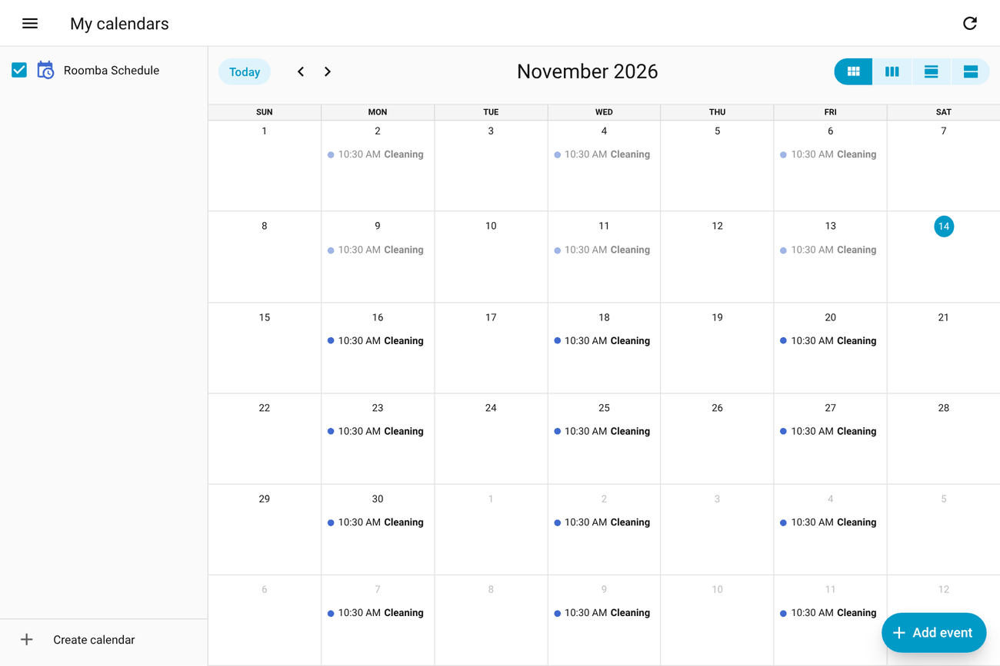

[Roomba+](../../README.md) › [Documentation](../README.md) › Schedules, presence and demand cleaning

# Schedules, presence and demand cleaning

The robot's schedule as a calendar, schedules that wait until everyone is out, cleaning when the floor is dirtier than usual, and rooms that are due. Holding a single start back while a door is open: [Start only when the house is ready](start-conditions.md).

## The schedule as a calendar

**Applies to:** all robots · on by default (Configure → Connection settings → *Show cleaning schedules as a calendar*)

`calendar.{name}_schedule` (`calendar.{name}_prime_schedule` on Prime) shows the robot's cleaning schedule as recurring Home Assistant calendar events. An empty calendar means no schedule is set. Each event lasts a fixed 60 minutes: iRobot's schedule carries a start time only, never a duration.

**You can write to it on every generation**: create, move or delete a cleaning in the calendar and it reaches the robot. A write replaces the robot's whole list, so entries Roomba+ does not understand are carried through untouched, and a 21st entry raises an error rather than losing one. Room names in the events come from every map on the account, not only the one drawn.

**Prime robots also have three actions** for scripts; the calendar is the usual way in on either generation:

| Action | What it does |
|---|---|
| `roomba_plus.create_schedule` | adds a schedule: days, time, and optionally which rooms |
| `roomba_plus.update_schedule` | changes an existing one, identified by its schedule id |
| `roomba_plus.delete_schedule` | removes one |

Each Prime schedule also has a switch to turn it on and off. **An update changes only what you name**: Roomba+ reads the schedule first, because the cloud has no partial update and a plain write would drop the days you did not mention. Editing in the calendar dialog takes the same path; Home Assistant sends only the fields you touched, so the frequency and the days are kept.

## Presence-aware scheduling

**Applies to:** Smart Map robots and Braava (the robot's schedule hold) · Prime · off by default

Keep the robot's schedule on hold while someone is home, and release it when everyone has left.

Configure → **Presence-aware scheduling**

| Option | What it does | Default |
|---|---|---|
| Enable | Turns it on | off |
| Tracked persons | One or more `person.*` entities | — |
| Mode | *Unfreeze when all away*, or *Fire event (manual control)* | Unfreeze when all away |
| Delay after leaving | Minutes to wait before releasing the hold (0–60) | 5 min |

Roomba+ only puts back a hold it set itself; a hold you set with the *Schedule hold* switch is left alone. Events: `roomba_plus_all_away` and `roomba_plus_person_detected_during_clean`.

**Presence analytics** come with it:

| Sensor | Notes |
|---|---|
| Clean opportunities (7 days) | Away windows long enough for a full clean |
| Clean utilisation (7 days) | Share of those windows that ended in a clean |
| Next likely clean window | A forecast from the away pattern |
| Optimal clean window | The best hour today; `window_is_today` says whether it is today or tomorrow |

## Demand cleaning

**Applies to:** Smart Map robots with the iRobot account · Prime · off by default

Start an extra clean when the floor is clearly dirtier than usual.

Configure → **Demand cleaning**

| Option | Default | What it does |
|---|---|---|
| Enable demand cleaning | off | Turns it on |
| Trigger multiplier | 1.5 | Classic: start when the mission's dirt is above the robot's usual level times this |

**Classic.** After each mission the dirt the robot reported is compared with its usual level for that weekday (or the 30-day median). A clean starts only when every gate is open: the robot is idle, no blocking sensor is on, everyone tracked is away (if presence mode says so), and the last demand clean is at least 6 hours ago. `binary_sensor.{name}_demand_clean_blocked` is on while a gate is closed, and `blocking_reason` names it.

**Prime.** The robot rates each room itself and sends its own threshold with the scores, so the step has the switch alone. After each finished mission that Home Assistant saw run, Roomba+ asks the robot and starts the dirtiest room past the threshold: one room, with the same gates and the same 6-hour gap, only with the robot on its dock, on the floor it is on. The gates are checked again right before the command. The mission sensor's `unfinished_rooms` attribute fills whenever the scores are read. There is no `demand_clean_blocked` sensor on Prime yet.

`roomba_plus.auto_clean_dirty_rooms` cleans the dirty rooms on demand: on Classic the rooms dirtier than your household's average, on Prime the rooms the robot rates dirty. Switching demand cleaning or presence scheduling on or off reloads the robot, so it takes effect at once.

## Rooms that are due

**Applies to:** Smart Map robots with the iRobot account · Prime

- **`sensor.{name}_rooms_overdue`** lists the rooms due for a clean. Each room's rhythm is learned from its own history; Configure → *Cleaning frequency per room* sets a fixed one (daily, every 2 days, 3× a week, weekly). The attributes carry a suggested interval per room and `daily_suggested`, the rooms that get dirty fast.
- **`roomba_plus.clean_overdue_rooms`** cleans everything that is due, worst first, in a route planned from the dock. It does nothing when nothing is due, so it is safe to call daily from an automation.
- **Cleaning cadence health**: a room that has gone clearly longer than its own usual rhythm without a clean gets a repair issue. The same is in the [REST API](../API.md) as `format=zone_coverage_health`.
- **Dirt and other sensors** (optional): pick sensors such as humidity or pollen under Configure → Connection settings → *Correlate dirt with sensors*. After 30 missions Roomba+ reports whether the robot collects more dirt when they are high. Calculated locally.

---

[Documentation home](../README.md) · [Troubleshooting](../TROUBLESHOOTING.md) · [Questions and reports](https://github.com/johnnyh1975/ha_roomba_plus/issues)
